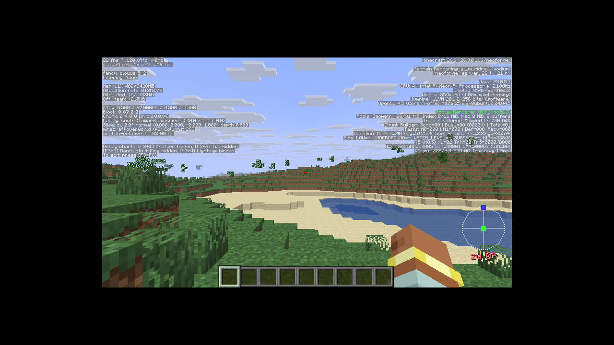
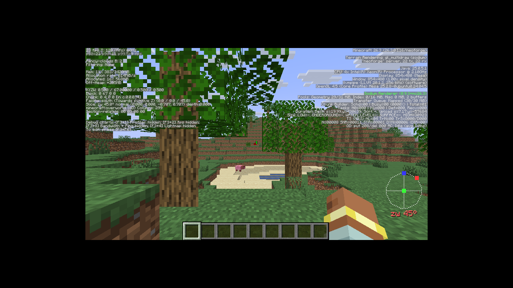
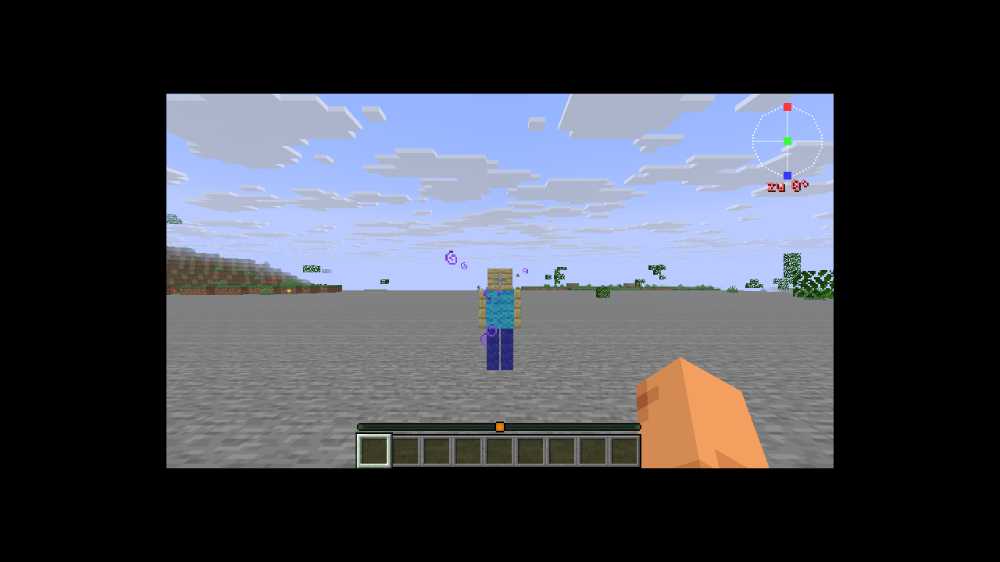

# Tetraform

A NeoForge mod for **Minecraft 26.3** (NeoForge `26.3.0.116`, Java 25) that adds a real fourth spatial
dimension. It does not stack copies of a 3D world. Every block is a unit tesseract, every position is a `Vec4`,
and everything you see is the 3D cross-section of a 4D world by your own viewing hyperplane, rendered as faces.

**It works out of the box:** with Tetraform installed, the *Default* world type creates a 4D overworld (the
Nether and End stay vanilla). `/tetra enter` also takes you to a separate 4D dimension from any world, including
worlds created before the mod was installed.

## What is four-dimensional

| System | How it works in 4D |
|---|---|
| **Positions** | `Vec4` / `BlockPos4` (x, y, z, **w**) for players, mobs, items and blocks. |
| **World storage** | 16×16×16×16 tesseract sections in palette-compressed, bit-packed storage, stacked into 256-tall columns keyed by (cx, cz, cw). They are saved in `<world>/tetraform4d/<dimension>/`. |
| **Terrain** | The height field is a function of (x, z, w). Caves come from 4D simplex noise and trees grow hyperspherical canopies. Generation runs off-thread. |
| **Neighbours** | Every block has **8** face neighbours (`Direction4`: ±x, ±y, ±z, ±w). Face culling, redstone, fluids and light all use them. |
| **Physics** | Swept hyperbox collision on all four axes, with step-up, gravity, swimming and creative flight. |
| **Redstone** | Dust networks connect along all 6 horizontal directions (x, z **and w**) plus up and down steps. Levers, buttons, redstone blocks, torches, lamps and conductive blocks all work. |
| **Fluids / gravity / TNT** | Water and lava spread in 6 horizontal directions, form infinite sources and mix into obsidian and cobblestone. Sand and gravel fall. TNT blows up a 4D hyperball. |
| **Mobs** | Hyperhogs (passive, with 8 legs, one per (x′, z′, w′) corner) and Stalkers (hostile). Their AI wanders, chases and flees in random 4D directions. Their orientation is a full rotation of the (x, z, w) space, and they turn smoothly through W toward where they walk. |
| **Commands** | 4 numbers per coordinate: `/setblock x y z w <block>`, `/fill x1 y1 z1 w1 x2 y2 z2 w2 <block> [replace\|keep\|hollow\|outline]` (**8** numbers), `/clone`, `/tp x y z w [yaw pitch zw]`, `/tp <players> x y z w [yaw pitch zw]`, `/summon tetraform:hyperhog x y z w`. `~` relative coordinates work. The 3-coordinate vanilla forms still work. |
| **Movement** | Vanilla's physics model ported to 4D: the same acceleration, friction, gravity order (a jump clears a full block), sprint-jump and sneak. Input is normalised across all three horizontal axes, so diagonals and W-strafing are never faster. |
| **Fluids** | Rendered like vanilla, with sloped, smoothly connected surfaces (each corner averages its 4D neighbours). Flow follows vanilla's "toward the nearest drop" rule and drains when the source is removed. Caves are generated so they never open into lakes. |

## The 4D camera

The view is built in the same order as the reference camera:

1. **xz**: yaw (mouse left/right).
2. **yd**: pitch (mouse up/down).
3. **zw**: the world's z axis rotated into w by your **zw angle**.

This gives forward = (sin xz, cos xz·cos zw, cos xz·sin zw) and the matching right vector, so walking at
zw = 90° moves you through W. The visible hyperplane is spanned by x, y and the rotated z axis. Its normal,
(0, −sin zw, cos zw), depends **only on zw**, which has three consequences:

* Mouse look never changes which slice you see, so it costs nothing.
* Every tesseract cuts into a **rectangular box**: the x and y extents stay 1 and only the depth along the
  rotated axis changes. At zw = 0°, 90°, 180° and 270° every block is a perfect cube (you see the x-y-z,
  x-y-w, … slices). Tests check that every face of every zw slice is a rectangle.
* While you rotate, the world turns around **you**: your on-screen position stays fixed instead of jumping.

A note on the Python demo: its "dynamic" projection uses depth = cos(zw)·z′ + sin(zw)·w′. Because z′ and w′
were just rotated by that same angle, this simplifies to the *unrotated* z. So the demo draws the world as
if zw were 0 and ignores w on screen. That is why its wireframes always stay perfect cubes. Tetraform
keeps the demo's rotation order and movement vectors but really shows the rotated slice, so W becomes visible.
The blocks stay boxes, but between quarter turns they stretch in depth.

## Rendering: faces, not lines

`Slicer` intersects each tesseract's 8 bounding cells with your hyperplane. Each cut is a convex polygon:
vertical rectangles from the x, z and w cells, and 3- to 6-gons from the top and bottom cells. Together they
form a closed polyhedron. Unit tests check closure with the divergence theorem and check the back-face winding.
The faces are emitted through NeoForge's `AddSectionGeometryEvent` into **normal chunk-section meshes**, with
real block textures from the baked models (grass overlays and tints included), directional shading for any
normal (W faces included), 4D sky light from the 3D heightmap, and block light from 4D emitters.

Mobs, items and other players are sliced every frame, exactly in their own rotated frames. They are submitted
through vanilla entity render types.

### Blocks with real models

Full cubes are sliced exactly. Every other block (grass, flowers, torches, slabs, stairs, fences…) is drawn
with its **actual vanilla 3D model**, placed in the block's cross-section of your slice. Since every zw slice of a block is a box,
the model fits exactly: at 0°/90°/180°/270° blocks look exactly like vanilla, and in between they stretch in
depth along the rotated axis. The selection outline is vanilla's own outline renderer drawing the block's real
shape the same way.

### Sodium / Iris compatibility

* There are no Sodium or Iris mixins. Terrain goes through the section-geometry event, which Sodium supports,
  so Sodium's culling, meshing threads and draw batching apply to 4D terrain automatically.
  **Tested with Sodium 0.9.3+mc26.3** (screenshots were taken with it installed).
* Iris shades chunk-section geometry and vanilla entity render types, so shader packs, shadow pass included,
  apply to the 4D world with no special handling. **Not tested yet.** The only Iris build for 26.3 is
  1.11.7, which Sodium 0.9.3 rejects (it needs Iris ≥ 1.12.1). Sodium 0.9.2, the version Iris 1.11.7
  accepts, crashes on NeoForge 26.3.0.116 on its own, before Tetraform does anything.

## Performance

* Palette-compressed sections (a uniform section costs a few bytes), with an atomic palette/data swap so mesh
  workers read without locks.
* Generation and disk IO run on worker threads. Caves use a coarse 4D noise grid with quadrilinear
  interpolation, about 100× fewer noise samples.
* Streaming sends only what you can see: a small full-4D neighbourhood for physics, plus the columns that
  actually cross your hyperplane within view distance. Columns are deflate-compressed and decoded off-thread
  on the client.
* The mesher solves the plane equation to visit **only** the voxels that intersect the hyperplane: O(16²) per
  section, never O(16⁴). Faces are culled across all 8 directions. Slicing allocates nothing per face.
* Remeshing happens only when the hyperplane changes. Axis-aligned slices change only when you cross an
  integer W. Block updates remesh only the sections they project into.
* **Near-first remeshing:** while you rotate or move along W, only sections within 3 sections of you
  rebuild each step. Everything else rebuilds once you stop for 0.2 s (and at least once a second).
  Close terrain stays correct at full speed, and distant terrain catches up a moment later.
* **Face-exposure cache:** each section caches which of its voxels' eight faces are visible. The mesher skips
  buried voxels without any neighbour lookups, and the cache only changes when nearby blocks do.
* The server caps scheduled block ticks per tick (count and time), so big water or redstone events slow
  down instead of stalling the server.

## Controls

All of these are in **Options → Controls → Key Binds → Tetraform (4D)** and can be rebound to any key or
mouse button. They work out of the box:

| Default | Action |
|---|---|
| Hold **Left Alt** + **scroll wheel** | Rotate into W, 5° per notch. While the modifier is held, scrolling does **not** change the hotbar slot. |
| **Mouse button 5** / **Mouse button 4** (side buttons) | Smoothly rotate toward +W / −W while held (60°/s). These are optional; if your mouse has no side buttons, rebind them, e.g. to `G` / `H`. |
| `Z` / `X` / `C` / `B` | Snap the W rotation to 270° ("left"), 0° ("forward"), 90° ("right"), 180° ("backward") |
| `R` / `V` | Strafe ana / kata along the hidden axis. Like A/D, this follows your view: from the spawn orientation it is +W / −W, and it turns with the zw rotation. |
| Middle click | Pick block (vanilla rules: hotbar, then inventory, then creative supply) |
| Right click a mob | Hyperhogs eat carrots, potatoes and beetroot: this heals them, and two fed hogs make a (smaller) baby |

Vanilla also binds `X` and `C` (creative toolbar load/save activators), and Iris binds `R` (reload shaders),
so the Controls screen flags those conflicts; rebind whichever you prefer.

**F3 is four-dimensional.** In a 4D world, the vanilla debug entries show 4D data with their usual layout:
`XYZW`, `Block x y z w`, `Chunk cx cy cz cw`, `Facing: ana (Towards positive W) (yaw / pitch / zw)`, a `Slice`
line (zw angle, hyperplane normal, depth), 4D section-relative coordinates, the targeted 4D block and face,
4D light, the 4D surface height and the terrain type. A dial in the top-right corner shows zw (red), yaw (blue) and pitch
(green).

Pressing a 4D control in a 3D world shows a hint explaining why nothing happens.

Commands: `/tp x y z w [yaw pitch zw]` (each rotation accepts `~`), `/tetra enter`, `/tetra leave`, `/tetra where`,
`/tetra rotate <deg>` (adds to zw), `/tetra reset`, `/tetra explode x y z w [power]`, `/tetra killmobs`. These are
debug helpers: `/tetra fluids` (fluid counts nearby), `/tetra probe x y z w` (a block and its 8 neighbours) and
`/tetra trace x y z w` (follows a flow back to whatever feeds it).

## Building

Every push builds automatically on GitHub. Open the repository's **Actions** tab, click the latest
**Build** run, and download the `tetraform-<commit>` artifact under **Artifacts**. It is a zip that contains
the mod jar. You must be logged in to GitHub to download artifacts.

To build locally:

```
./gradlew build            # -> build/libs/tetraform-0.1.0.jar (needs JDK 25)
./gradlew test             # 4D math tests
./gradlew runClient        # optional: -PautoJoin=host:port
./gradlew runServer
```

## Known limitations

* Vanilla blocks with special mechanics outside those listed above (pistons, repeaters, comparators, hoppers,
  containers with GUIs, crops) are placed and rendered, but they have no 4D behaviour yet.
* Non-cube shapes are lifted to hyperboxes (slabs span the full W range; torches and posts are thin in W),
  rendered with the face sprite of their model. They are not rendered with their full 3D model.
* Lighting is approximate: sky light comes from the 4D heightmap, and block light from emitters by 4D
  Manhattan distance. It is not a full flood fill.
* While zw changes, all visible sections rebuild (the chunk mesher has no per-frame path). With Sodium this
  is quick, but during fast turns, distant sections can lag a moment behind nearby ones.
* Upgrading from 0.1.0: the key-binding ids changed so the new defaults apply; earlier custom bindings for
  Tetraform keys need to be set again.
* Worlds created before this version can contain caves that open into lakes, and those can still flood if
  disturbed. New worlds don't have such caves.
* Iris: terrain is ordinary chunk-section geometry, which the shadow pass renders, so terrain shadows should
  work. Mobs, items and other players are drawn per frame through a separate path that the shadow pass doesn't
  replay, so they cast no shadows. This could not be verified in-game yet: the only Iris build for 26.3 (1.11.7)
  is rejected by Sodium 0.9.3 (it requires Iris ≥ 1.12.1). With Sodium 0.9.3-beta.3 it loads, but crashes
  inside Iris itself (`CenterDepthSampler`) as soon as a shader pack is enabled.

## Screenshots

These were rendered in-game with software OpenGL and Sodium 0.9.3, in a fresh *Default* world with F3 open.

| zw 0° (x-y-z slice) | zw 45° (boxes stretched in depth) | zw 90° (x-y-w slice, cubes again) |
|---|---|---|
|  |  |  |

| Real block models + vanilla outline | Water flowing downhill | Two players (multiplayer) |
|---|---|---|
|  |  |  |

| Ordinary slice (0.1.0) | A Stalker (sliced 4D body) |
|---|---|
|  |  |
