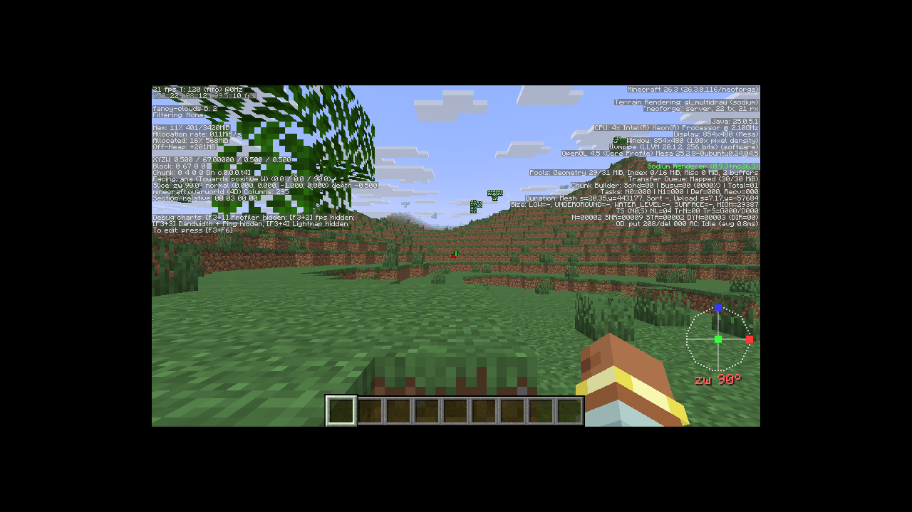
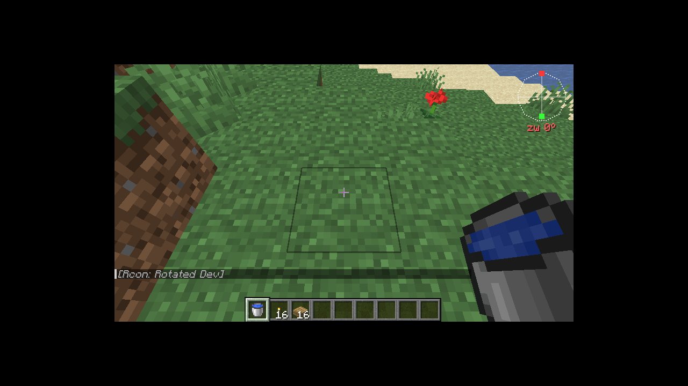
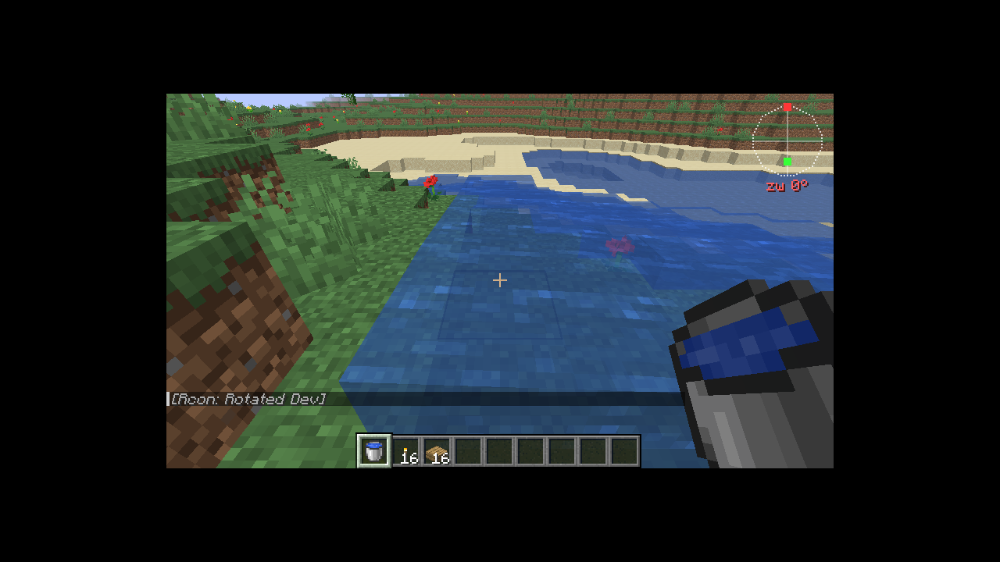
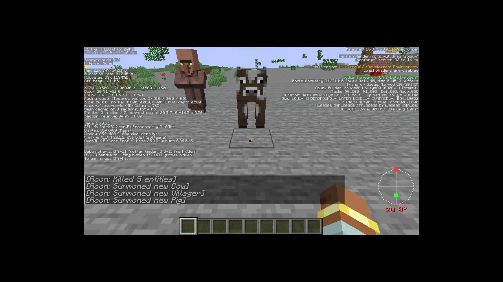
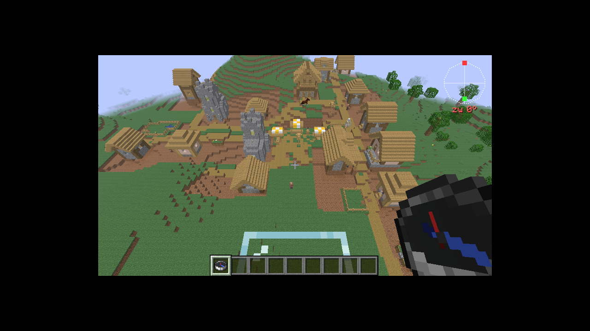
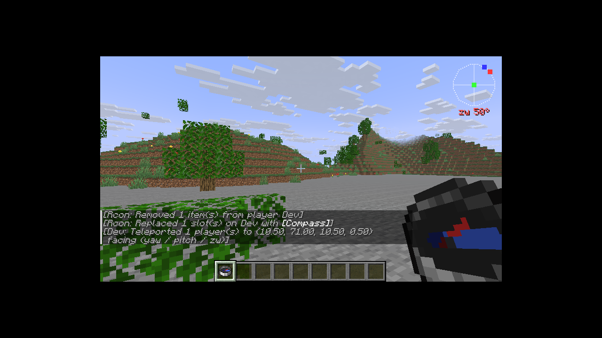
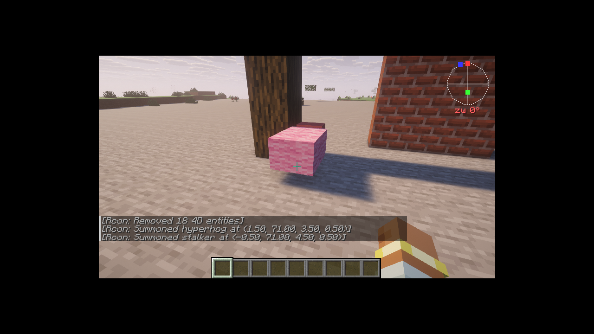
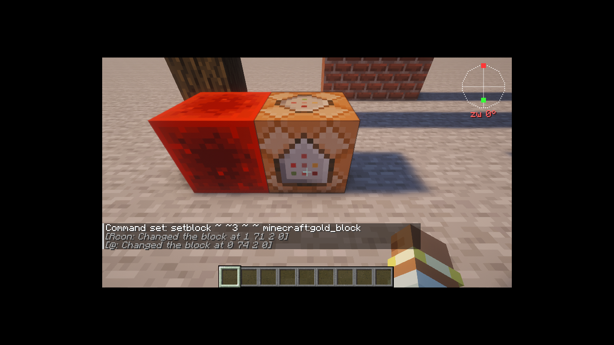
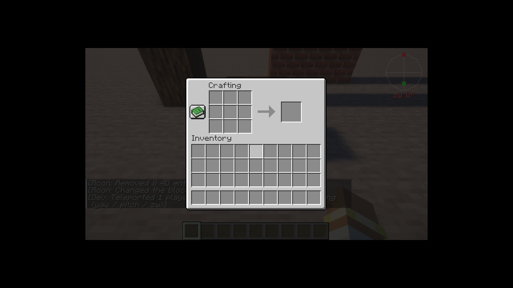
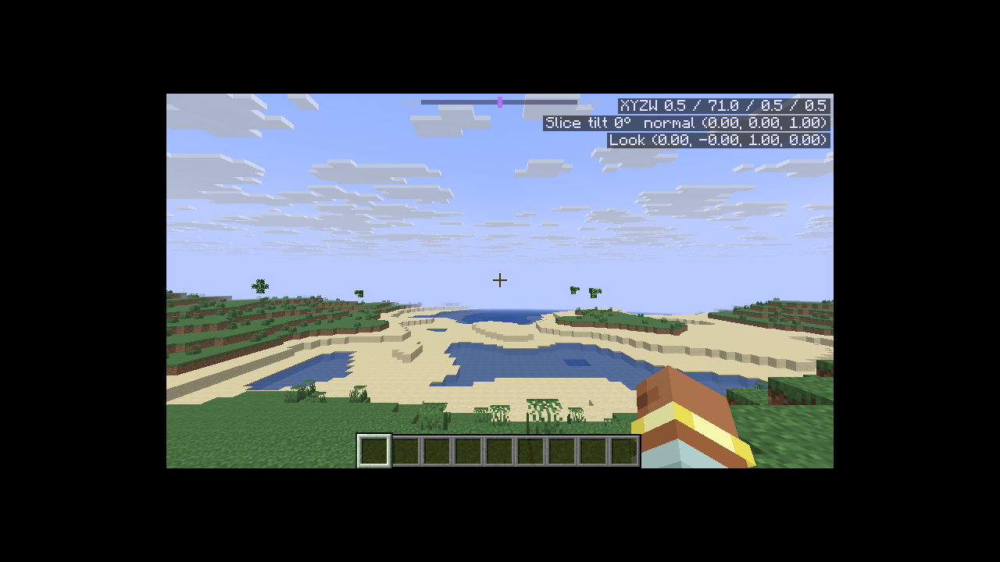

# Tetraform

A NeoForge mod for **Minecraft 26.3** (NeoForge `26.3.0.116`, Java 25) that adds a real fourth spatial
dimension. It does not stack copies of a 3D world. Every block is a unit tesseract, every position is a `Vec4`,
and everything you see is the 3D cross-section of a 4D world by your own viewing hyperplane, rendered as faces.

**It works out of the box:** with Tetraform installed, the *Default* world type creates a 4D world: overworld,
Nether and End are all four-dimensional. A 4D world made with an older version gets a 4D Nether and End the next
time it loads (whatever was built in its old 3D Nether and End is cleared as those chunks load). `/tetra enter` also takes you to a separate 4D dimension from any world, including
worlds created before the mod was installed.

## What is four-dimensional

| System | How it works in 4D |
|---|---|
| **Positions** | `Vec4` / `BlockPos4` (x, y, z, **w**) for players, mobs, items and blocks. |
| **World storage** | 16×16×16×16 tesseract sections in palette-compressed, bit-packed storage, stacked into 256-tall columns keyed by (cx, cz, cw). They are saved in `<world>/tetraform4d/<dimension>/`. |
| **Terrain** | The height field is a function of (x, z, w). Caves come from 4D simplex noise and trees grow hyperspherical canopies. Generation runs off-thread. |
| **Neighbours** | Every block has **8** face neighbours (`Direction4`: ±x, ±y, ±z, ±w). Face culling, redstone, fluids and light all use them. |
| **Physics** | Swept hyperbox collision on all four axes, with step-up, gravity, swimming and creative flight. You only collide with blocks drawn in your slice: you can't stand on, bump into or enter a portal you can't see one layer over along the hidden axis. |
| **Redstone** | Dust networks connect along all 6 horizontal directions (x, z **and w**) plus up and down steps. Levers, buttons, redstone blocks, torches, lamps and conductive blocks all work. |
| **Fluids / gravity / TNT** | Water and lava spread in 6 horizontal directions, form infinite sources and mix into obsidian and cobblestone. Sand and gravel fall. TNT blows up a 4D hyperball. |
| **Creatures** | **Every vanilla creature** (animals, monsters, villagers, iron golems) and every item entity has a W coordinate. Each one runs its normal vanilla AI inside its own x-y-z slice, so pathfinding, line of sight, sun burning and doors all work against the 4D world. Creatures drift into neighbouring W layers now and then, and a hunting monster lines its W up with its target. They are drawn with their **vanilla models** (player skins and skin-layer mods included). They only see, attack and collide with things in their own slice. Your W rotation changes only what you see: when you snap ana with `Z`, a cow looking at you doesn't appear to turn. Walk forward and you leave its slice, so it disappears. |
| **Structures** | Vanilla **villages** (built from vanilla's own template pools, with villagers, golems and animals), **ruined portals**, **igloos** and **shipwrecks**. Each one takes two of the horizontal axes as its basis: template x/z become (x, z), (z, x), (x, w) or (w, x), and it is one layer thick along the remaining axis. An x-w village is seen whole at zw 90°; a transposed one comes out mirrored. |
| **Commands** | 4 numbers per coordinate: `/setblock x y z w <block> [replace\|keep\|destroy]`, `/fill x1 y1 z1 w1 x2 y2 z2 w2 <block> [replace [filter]\|keep\|hollow\|outline\|destroy]` (**8** numbers), `/clone <begin> <end> <dest> [replace\|masked\|filtered <filter>] [force\|move\|normal]`, `/tp [targets] x y z w [yaw pitch zw]` (any entities, not only players), `/summon <entity> x y z w [nbt]`, `/execute if\|unless block x y z w <block>`. `~` works, and so does `^left ^up ^forward ^ana` (along your view, through your zw rotation). `~` follows `/execute as`, `at` and `positioned` like vanilla, W included. Vanilla forms keep the W in a 4D world: `/tp <entity>` goes to that entity's full 4D position, `/tp x y z` and `/summon <entity> [x y z]` stay in the executor's W, and `/locate structure <village\|ruined portal\|igloo\|shipwreck>` finds the 4D structures. |
| **Movement** | Vanilla's physics model ported to 4D: the same acceleration, friction, gravity order (a jump clears a full block), sprint-jump and sneak. Input is normalised across all three horizontal axes, so diagonals and W-strafing are never faster. |
| **Fluids** | Rendered like vanilla, with sloped, smoothly connected surfaces (each corner averages its 4D neighbours). Flow follows vanilla's "toward the nearest drop" rule and drains when the source is removed. Caves are generated so they never open into lakes. |

## The 4D camera

The view is built in the same order as the reference camera:

1. **xz**: yaw (mouse left/right).
2. **yd**: pitch (mouse up/down).
3. **zw**: the world's z axis rotated into w by your **zw angle**.

This gives forward = (sin xz, cos xz·cos zw, cos xz·sin zw) and the matching right vector, so walking at
zw = 90° moves you through W. The visible hyperplane is spanned by x, y and the rotated z axis. Its normal,
(0, −sin zw, cos zw), depends **only on zw**, which has three consequences:

* Mouse look never changes which slice you see, so it costs nothing.
* Every tesseract cuts into a **rectangular box**: the x and y extents stay 1 and only the depth along the
  rotated axis changes. At zw = 0°, 90°, 180° and 270° every block is a perfect cube (you see the x-y-z,
  x-y-w, … slices). Tests check that every face of every zw slice is a rectangle.
* While you rotate, the world turns around **you**: your on-screen position stays fixed instead of jumping.

A note on the Python demo: its "dynamic" projection uses depth = cos(zw)·z′ + sin(zw)·w′. Because z′ and w′
were just rotated by that same angle, this simplifies to the *unrotated* z. So the demo draws the world as
if zw were 0 and ignores w on screen. That is why its wireframes always stay perfect cubes. Tetraform
keeps the demo's rotation order and movement vectors but really shows the rotated slice, so W becomes visible.
The blocks stay boxes, but between quarter turns they stretch in depth.

## Rendering: faces, not lines

`Slicer` intersects each tesseract's 8 bounding cells with your hyperplane. Each cut is a convex polygon:
vertical rectangles from the x, z and w cells, and 3- to 6-gons from the top and bottom cells. Together they
form a closed polyhedron. Unit tests check closure with the divergence theorem and check the back-face winding.
The faces are emitted through NeoForge's `AddSectionGeometryEvent` into **normal chunk-section meshes**, with
real block textures from the baked models (grass overlays and tints included), directional shading for any
normal (W faces included), 4D sky light and block light from 4D emitters.

Sky light passes through leaves, glass, plants and water, and it spreads sideways under solid cover, one level
per block across all three horizontal axes (x, z and w). The ground under a tree stays lit; the ground under a
roof darkens toward the middle.

Creatures, items and other players are vanilla entities rendered by vanilla renderers. Each one is placed at its
position inside your slice, and it is hidden when its body doesn't cross your slice.

### Blocks with real models

Full cubes are sliced exactly. Every other block (grass, flowers, torches, slabs, stairs, fences…) is drawn
with its **actual vanilla 3D model**, placed in the block's cross-section of your slice. Since every zw slice of a block is a box,
the model fits exactly: at 0°/90°/180°/270° blocks look exactly like vanilla, and in between they stretch in
depth along the rotated axis. The selection outline is vanilla's own outline renderer drawing the block's real
shape the same way.

### Other mods (Jade, WTHIT, minimaps...)

Tetraform publishes the 4D world through the standard vanilla client state, so mods that ask "what is the player
looking at" or "what block is here" work without knowing about 4D:

* `Minecraft.hitResult` and `crosshairPickEntity` hold the 4D crosshair target (block or creature), in the same
  render-space coordinates as the camera.
* On the render thread, `Level.getBlockState` / `getFluidState` answer from the slice you are looking at, so
  ray traces like Jade's, particles, shadows and the camera's water check see 4D blocks. `Level.getBlockEntity`
  answers for the targeted block too, so mods pick the right tooltip providers.
* **Jade's server data** works: chest and furnace contents, spawner mobs, beehives, modded machines. The client
  tells the server which 4D block its crosshair is on, and while Jade's server side answers, vanilla block and
  block-entity access is mapped to the 4D world around that block, so every Jade provider (Jade's own and other
  mods') reads the real block entity. This only needs Jade's ordinary request; nothing else changes.
* The vanilla block outline is replaced by Tetraform's own (via `ExtractBlockOutlineRenderStateEvent`), since only
  Tetraform knows the block's cut through the slice.

### Sodium / Iris compatibility

**Supported pairing: Sodium 0.9.3-beta.1 + Iris 1.11.7** (the release Sodium 0.9.3 refuses Iris 1.11.7).
Tested in-game with **Mellow v3.5** and **Photon v1.4** (shadows, waving plants, water, sunset and night at zw 0°, 45° and 90°) and earlier with Complementary Reimagined r5.10. Sodium and Iris are optional; Tetraform runs without them:

* There are no Sodium or Iris mixins. Terrain goes through the section-geometry event, so Sodium meshes, culls
  and batches 4D terrain, and Iris shades it like normal terrain. **Terrain casts shadows.**
* Creatures, items and other players are ordinary vanilla entities in the normal entity pipeline, so shader
  packs include them in every pass. (Entity shadows were verified with the earlier proxy renderer; this
  version uses vanilla entities directly and was only re-tested with shaders off.)
* Developers: Iris trips Blaze3D's strict validation, which only runs in dev environments. Use
  `./gradlew runClient -PnoValidation` to match a production launcher.

## Performance

* Palette-compressed sections (a uniform section costs a few bytes), with an atomic palette/data swap so mesh
  workers read without locks.
* Generation and disk IO run on worker threads. Caves use a coarse 4D noise grid with quadrilinear
  interpolation, about 100× fewer noise samples.
* Streaming sends only what you can see: a small full-4D neighbourhood for physics, plus the columns that
  actually cross your hyperplane within view distance. Columns are deflate-compressed and decoded off-thread
  on the client.
* The mesher solves the plane equation to visit **only** the voxels that intersect the hyperplane: O(16²) per
  section, never O(16⁴). Faces are culled across all 8 directions. Slicing allocates nothing per face.
* Remeshing happens only when the hyperplane changes. Axis-aligned slices change only when you cross an
  integer W. Block updates remesh only the sections they project into.
* **Mesh cache, like vanilla's compiled chunks:** the slice is cut into 16³ *cells* in its own coordinates
  (independent of where they land on screen) and each finished cell is kept, keyed by angle, depth and a stamp
  of the 4D columns that can affect it (up to a quarter of the heap, at most 3 GB). Turning back to an angle you
  have seen, snapping to it, or stepping back along W copies stored geometry instead of slicing again, and an
  edit only invalidates the cells near it.
* **Background slicing with honest loading:** after a turn or teleport, any cell not cached yet is built on
  background threads and shows as empty space until it's ready, nearest first, the way vanilla chunks stream in
  after a teleport. The old slice is never left on screen. While you hold still, the workers fill in the rest of
  the slice within render distance (so looking around after a turn is instant) and then the slices you are
  likely to see next: the next rotation steps in the direction you last turned and one step either way along W.
  Small depth steps while walking keep the previous mesh until the new one is ready, since it is nearly the same
  picture. F3 shows the cache size and the queue.
* **Bigger preload:** the full 4D neighbourhood within 3 columns (all of x, z and w) stays loaded, so rotating
  into W or strafing along W doesn't wait for terrain to stream. `preloadRadius` in `tetraform-synced.toml`
  goes up to 6 (4 suits 16 GB).
* Lighting is calculated without per-face allocations, from only the light sources that can reach the section,
  and non-cube block models are cached per state.
* **Face-exposure cache:** each section caches which of its voxels' eight faces are visible. The mesher skips
  buried voxels without any neighbour lookups, and the cache only changes when nearby blocks do.
* The server caps scheduled block ticks per tick (count and time), so big water or redstone events slow
  down instead of stalling the server.

## Blocks, items and other mods: vanilla's own code, run in 4D

Right-clicking a 4D block runs **vanilla's own interaction code** (the same path as vanilla's packet handler,
including NeoForge's `RightClickBlock` event), with the level mapped to the clicked block's W slice: every
`Level.getBlockState`, `setBlock`, `getBlockEntity`, scheduled tick, light and height query answers from the 4D
world. Using an item in the air works the same way, in your own slice. So it all behaves like vanilla:

* **Every block entity is vanilla's own**: chests (double chests too), barrels, shulker boxes, furnaces, smokers
  and blast furnaces (they smelt), hoppers (they move items), brewing stands, dispensers, beacons, signs, banners,
  beds, bells, spawners, and modded machines and storage. They are saved next to each column (chests from 0.1
  saves are converted, items kept) and tick in their own W slice. Menus close like vanilla when you walk away.
* **Placement** uses vanilla's rules (stairs, slabs, double slabs, beds, doors, signs with their edit screen,
  banners, placed modded blocks), and so do hoes, shovels, axes, bone meal, flint and steel, buckets of fish...
  Placing against a W face (ana/kata) still uses Tetraform's own placement.
* **Vanilla block behaviour** reaches 4D: neighbour and shape updates (fences, panes and walls connect, torches pop
  off, leaves decay), scheduled ticks (buttons, repeaters, observers, fire) and random ticks (crops and saplings
  grow, grass spreads, ice melts) run in each block's slice. Gravity, fluids, redstone dust, torches, lamps, TNT
  and command blocks keep their 4D versions, which act along all eight directions.
* **Other mods** that use these standard paths work without knowing about 4D: block-entity capabilities (item and
  fluid handlers for pipes and hoppers), menus, placeable and right-clickable items such as backpacks, and anything
  that reads `Minecraft.hitResult` (Jade shows the block or creature under the 4D crosshair).
* **Command blocks:** the vanilla command block screen, with impulse, repeat and chain modes, conditional and
  always-active settings, redstone triggering and output tracking. `~ ~ ~ ~` in a command refers to the command
  block's own 4D position, so `setblock ~ ~1 ~ ~ stone` works in any W.

## Survival in 4D

* **Nether portals:** build the obsidian frame in the x-y, z-y **or w-y** plane and light it (a frame turned a
  quarter turn into W works too). Travel uses vanilla's 8:1 scaling on x, z **and W**, and links to an existing
  portal nearby in 4D before building a new one.
* **The Nether is 4D:** netherrack caverns carved by 4D noise between bedrock floor and roof, a lava sea at y 31,
  glowstone, quartz, nether gold and ancient debris, and the five biomes as regions of (x, z, w): nether wastes,
  crimson and warped forests (with huge fungi), soul sand valleys and basalt deltas. Their vanilla mobs spawn there
  (ghasts, piglins, hoglins, zombified piglins, magma cubes...).
* **Nether fortresses** are 4D: a nether brick hall with bridges out along ±x, ±z and ±w, each ending in a room.
  Every fortress has at least two blaze spawner rooms, a nether wart room and `nether_bridge` loot chests, and
  blazes and wither skeletons spawn inside.
* **The End:** stronghold portal rooms generate underground (fully 4D rooms with a lava pool, twelve frames and a
  silverfish spawner). An eye of ender flies toward the nearest one, and the remaining distance along W is shown
  above the hotbar. Fill the frames and vanilla opens the portal.
* **The End is 4D:** a 4D main island with vanilla's ten obsidian spikes (same places, heights and cages as
  vanilla) standing as 4D pillars, each with its crystal. You arrive on vanilla's obsidian platform in the W = 0
  layer, where the dragon fight happens: vanilla's own fight logic builds the exit portal, egg and gateways there.
  Past the void gap, outer islands float everywhere beyond 1000 blocks (in 4D distance) with chorus plants and
  **end cities** built by vanilla's end city generator (shulkers, loot, and the ship with its elytra).
  `/locate structure minecraft:stronghold` also works.
* **Dungeons:** mossy cobblestone rooms (4D, so closed along W too) with a zombie, skeleton or spider spawner and
  two chests with vanilla's dungeon loot. Village chests get their vanilla loot tables too.
* **Beds and respawn anchors** set a 4D spawn point (W included); you respawn there after death and after the
  End. Without one you respawn on the surface at the world spawn.
* **Ender pearls, chorus fruit, `/spreadplayers`** and other mods' teleporters move your 4D position too, keeping
  your W.
* **Elytra:** jump in mid-air to glide, with vanilla's flight physics extended to 4D (glide through W at a zw
  angle). Fireworks boost along your 4D look direction.
* **Light** is 4D everywhere it matters: monster spawning needs darkness (caves are dark, the surface is dark at
  night), spawners in lit rooms stay idle like vanilla, crops need light.

## Mobs

* **Caps:** mobs within 128 blocks of a player (4D distance) are counted; by default the hostile cap is vanilla's
  70 squared (4,900) and the passive cap vanilla's 10 cubed (1,000). Monsters spawn in groups in dark places
  (caves included), animals on lit grass, from vanilla's plains spawn lists.
* **Passive groups** are up to twice vanilla's size (`passiveGroupScale`).
* **Creepers** always deal reduced damage (`creeperDamage`, 0.5 by default, in every dimension). Whether they
  break blocks is a game rule, on by default: `/gamerule tetraform:creepers_spare_terrain false` restores vanilla
  griefing.
* **Despawning** follows vanilla's rules measured in 4D, and blasts only reach entities within their radius
  along W.
* **Cheaper far mobs:** mobs more than 48 blocks from every player tick every 2nd tick, past 96 blocks every
  4th (`throttleFarMobs`), and clients are only sent entities within 128 blocks in 4D (vanilla would send
  everything at your x/z in every W layer).
## Controls

All of these are in **Options → Controls → Key Binds → Tetraform (4D)** and can be rebound to any key or
mouse button. They work out of the box:

| Default | Action |
|---|---|
| Hold **Left Alt** + **scroll wheel** | Rotate into W, 5° per notch. While the modifier is held, scrolling does **not** change the hotbar slot. |
| **Mouse button 5** / **Mouse button 4** (side buttons) | Snap to the next quarter-turn view, cycling X → Z → B → C (forward) or X → C → B → Z (back). From between two views, forward snaps to the Z side and back to the X side. If your mouse has no side buttons, rebind them, e.g. to `G` / `H`. |
| `Z` / `X` / `C` / `B` | Snap the W rotation to 270° ("left", facing −W), 0° ("forward", +X), 90° ("right", +W), 180° ("backward", −X) |
| `R` / `V` | Strafe ana / kata along the hidden axis. Like A/D, this follows your view: from the spawn orientation it is +W / −W, and it turns with the zw rotation. |
| Middle click | Pick block (vanilla rules: hotbar, then inventory, then creative supply) |
| Left / right click a creature | Vanilla attack and interaction: breeding, trading, shearing, milking, riding… |

Vanilla also binds `X` and `C` (creative toolbar load/save activators), and Iris binds `R` (reload shaders),
so the Controls screen flags those conflicts; rebind whichever you prefer.

**F3 is four-dimensional.** In a 4D world, the vanilla debug entries show 4D data with their usual layout:
`XYZW`, `Block x y z w`, `Chunk cx cy cz cw`, `Facing: ana (Towards positive W) (yaw / pitch / zw)`, a `Slice`
line (zw angle, hyperplane normal, depth), 4D section-relative coordinates, the targeted 4D block and face,
4D light, the 4D surface height and the terrain type. A dial in the top-right corner shows zw (red), yaw (blue) and pitch
(green). F3 also counts the entities in your slice.

**The compass** works the same way as the dial: a larger blue needle points to its target (spawn or a lodestone)
inside your current slice, and a red needle in front of it shows the zw rotation.

Pressing a 4D control in a 3D world shows a hint explaining why nothing happens.

Commands: `/tp x y z w [yaw pitch zw]` (each rotation accepts `~`), `/tetra enter`, `/tetra leave`, `/tetra where`,
`/tetra rotate <deg>` (adds to zw), `/tetra reset`, `/tetra explode x y z w [power]`,
`/tetra locate [village|ruined_portal|igloo|shipwreck]` (prints the structure's plane and 4D position);
vanilla `/locate structure` finds the 4D villages, ruined portals, igloos, shipwrecks and strongholds. These are
debug helpers: `/tetra fluids` (fluid counts nearby), `/tetra probe x y z w` (a block and its 8 neighbours) and
`/tetra trace x y z w` (follows a flow back to whatever feeds it).

## Building

Every push builds automatically on GitHub. Open the repository's **Actions** tab, click the latest
**Build** run, and download the `tetraform-<commit>` artifact under **Artifacts**. It is a zip that contains
the mod jar. You must be logged in to GitHub to download artifacts.

To build locally:

```
./gradlew build            # -> build/libs/tetraform-0.3.5.jar (needs JDK 25)
./gradlew test             # 4D math tests
./gradlew runClient        # optional: -PautoJoin=host:port
./gradlew runServer
```

## Known limitations

* Pistons and other blocks that move blocks only act within one slice. Vanilla redstone components (repeaters,
  comparators, observers) work inside a slice and read 4D dust, but the 4D dust doesn't take power from them yet.
* Nether portals work in the x-y, z-y and w-y planes; tilted frames (at an in-between zw angle) don't light.
  End portal frames must be in an x-z plane, as in vanilla.
* Non-cube shapes are lifted to hyperboxes (slabs span the full W range; torches and posts are thin in W),
  rendered with the face sprite of their model. They are not rendered with their full 3D model.
* Lighting is approximate: sky light uses the 4D canopy and spreads up to 4 blocks sideways, and block light
  comes from emitters by 4D Manhattan distance. It is not a full flood fill.
* Structures appear only in terrain generated with this version. Structure processors (mossy variation, crops) are
  skipped. Maps are not 4D-aware.
* A slice you have never seen still has to be cut once: during a fast first turn, distant terrain appears a
  moment after nearby terrain (empty until then, never stale).
* Villages generated before this version keep their bare dirt street tiles (template air used to be written into
  the terrain); new terrain is generated correctly.
* WTHIT and other tooltip mods see blocks and creatures through vanilla's client state; only Jade's server data
  is bridged so far.
* Nether biomes are 4D regions, but the client's vanilla biome (fog colour, ambient particles, music) is nether
  wastes everywhere. Bastions and ruined portals don't generate in the Nether yet.
* Upgrading from 0.1.0: the key-binding ids changed so the new defaults apply; earlier custom bindings for
  Tetraform keys need to be set again.
* Worlds created before this version can contain caves that open into lakes, and those can still flood if
  disturbed. New worlds don't have such caves.
* Dispensers and droppers don't fire from 4D redstone yet. Bookshelves count for enchanting only within your slice.

## Screenshots

These were rendered in-game with software OpenGL and Sodium 0.9.3, in a fresh *Default* world with F3 open.

| zw 0° (x-y-z slice) | zw 45° (boxes stretched in depth) | zw 90° (x-y-w slice, cubes again) |
|---|---|---|
|  |  |  |

| Real block models + vanilla outline | Water flowing downhill | Two players (multiplayer) |
|---|---|---|
|  |  |  |

| Vanilla cow and villager in your slice | An x-z plane village | The compass (zw 50°) |
|---|---|---|
|  |  |  |

| Iris + Complementary: a (0.2) Hyperhog casting a shadow | 4D command block | Crafting table |
|---|---|---|
|  |  |  |

| Ordinary slice (0.1.0) |
|---|
|  |
