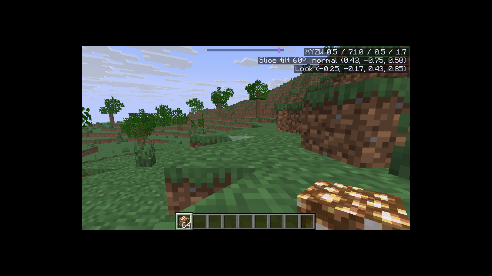
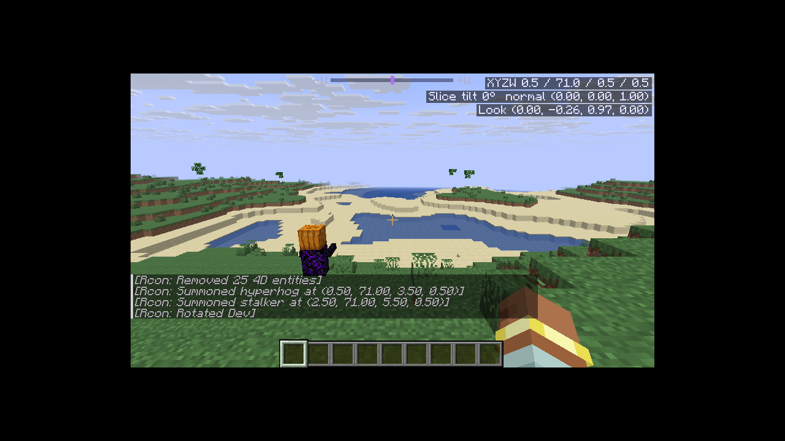

# Tetraform

A NeoForge mod for **Minecraft 26.3** (NeoForge `26.3.0.116`, Java 25) that adds a real fourth spatial
dimension. It does not stack copies of a 3D world. Every block is a unit tesseract, every position is a `Vec4`,
and everything you see is the 3D cross-section of a 4D world by your own viewing hyperplane, rendered as faces.

## What is four-dimensional

| System | How it works in 4D |
|---|---|
| **Positions** | `Vec4` / `BlockPos4` (x, y, z, **w**) for players, mobs, items and blocks. |
| **World storage** | 16×16×16×16 tesseract sections in palette-compressed, bit-packed storage, stacked into 256-tall columns keyed by (cx, cz, cw). They are saved in `<world>/tetraform4d/`. |
| **Terrain** | The height field is a function of (x, z, w). Caves come from 4D simplex noise and trees grow hyperspherical canopies. Generation runs off-thread. |
| **Neighbours** | Every block has **8** face neighbours (`Direction4`: ±x, ±y, ±z, ±w). Face culling, redstone, fluids and light all use them. |
| **Physics** | Swept hyperbox collision on all four axes, with step-up, gravity, swimming and creative flight. |
| **Redstone** | Dust networks connect along all 6 horizontal directions (x, z **and w**) plus up and down steps. Levers, buttons, redstone blocks, torches, lamps and conductive blocks all work. |
| **Fluids / gravity / TNT** | Water and lava spread in 6 horizontal directions, form infinite sources and mix into obsidian and cobblestone. Sand and gravel fall. TNT blows up a 4D hyperball. |
| **Mobs** | Hyperhogs (passive, with 8 legs, one per (x′, z′, w′) corner) and Stalkers (hostile). Their AI wanders, chases and flees in random 4D directions. Their orientation is a full rotation of the (x, z, w) space, and they turn smoothly through W toward where they walk. |
| **Commands** | 4 numbers per coordinate: `/setblock x y z w <block>`, `/fill x1 y1 z1 w1 x2 y2 z2 w2 <block> [replace\|keep\|hollow\|outline]` (**8** numbers), `/clone`, `/tp x y z w`, `/tp <players> x y z w`, `/summon tetraform:hyperhog x y z w`. `~` relative coordinates work. The 3-coordinate vanilla forms still work. |

## The 4D camera

The rotation composes in the order you asked for:

1. **xz**: ordinary yaw (the mouse).
2. **forward ↔ w**: the *Rotate view into ±W* keys rotate your current forward direction into the W axis.
3. **forward ↔ y**: ordinary pitch (the mouse).

The two horizontal rotations never touch Y, so their accumulated result is stored as a rotation matrix over
(x, z, w) (`SliceFrame`). Yaw and pitch stay vanilla angles inside your slice. Two things follow from this:

* Mouse look **never changes which slice you see**, so it costs nothing.
* Only rotating into W or moving along W changes the hyperplane, and only then do terrain meshes rebuild.
  Rotating 90° into W at yaw 0 gives you an exact x/y/w view.

## Rendering: faces, not lines

`Slicer` intersects each tesseract's 8 bounding cells with your hyperplane. Each cut is a convex polygon:
vertical rectangles from the x, z and w cells, and 3- to 6-gons from the top and bottom cells. Together they
form a closed polyhedron. Unit tests check closure with the divergence theorem and check the back-face winding.
The faces are emitted through NeoForge's `AddSectionGeometryEvent` into **normal chunk-section meshes**, with
real block textures from the baked models (grass overlays and tints included), directional shading for any
normal (W faces included), 4D sky light from the 3D heightmap, and block light from 4D emitters.

Mobs, items and other players are sliced every frame, exactly in their own rotated frames. They are submitted
through vanilla entity render types.

### Sodium / Iris compatibility

* There are no Sodium or Iris mixins. Terrain goes through the section-geometry event, which Sodium supports,
  so Sodium's culling, meshing threads and draw batching apply to 4D terrain automatically.
  **Tested with Sodium 0.9.3+mc26.3** (screenshots were taken with it installed).
* Iris shades chunk-section geometry and vanilla entity render types, so shader packs, shadow pass included,
  apply to the 4D world with no special handling. **Not tested yet.** The only Iris build for 26.3 is
  1.11.7, which Sodium 0.9.3 rejects (it needs Iris ≥ 1.12.1). Sodium 0.9.2, the version Iris 1.11.7
  accepts, crashes on NeoForge 26.3.0.116 on its own, before Tetraform does anything.

## Performance

* Palette-compressed sections (a uniform section costs a few bytes), with an atomic palette/data swap so mesh
  workers read without locks.
* Generation and disk IO run on worker threads. Caves use a coarse 4D noise grid with quadrilinear
  interpolation, about 100× fewer noise samples.
* Streaming sends only what you can see: a small full-4D neighbourhood for physics, plus the columns that
  actually cross your hyperplane within view distance. Columns are deflate-compressed and decoded off-thread
  on the client.
* The mesher solves the plane equation to visit **only** the voxels that intersect the hyperplane: O(16²) per
  section, never O(16⁴). Faces are culled across all 8 directions. Slicing allocates nothing per face.
* Remeshing happens only when the hyperplane changes. Axis-aligned slices change only when you cross an
  integer W. Block updates remesh only the sections they project into.

## Controls

| Key (rebindable) | Action |
|---|---|
| `R` / `V` | Move ana (+W) / kata (−W) along your slice normal |
| `G` / `B` | Rotate your view forward into +W / −W |
| `N` | Reset the slice to the ordinary XYZ orientation |

The HUD shows your true XYZW position, the slice tilt and normal, your 4D look vector, and a W compass.
F3 shows *render-space* coordinates, not world coordinates.

Commands: `/tetra enter`, `/tetra leave`, `/tetra where`, `/tetra rotate <deg>`, `/tetra reset`,
`/tetra explode x y z w [power]`, `/tetra killmobs`.

## Building

Every push builds automatically on GitHub. Open the repository's **Actions** tab, click the latest
**Build** run, and download the `tetraform-<commit>` artifact under **Artifacts**. It is a zip that contains
the mod jar. You must be logged in to GitHub to download artifacts.

To build locally:

```
./gradlew build            # -> build/libs/tetraform-0.1.0.jar (needs JDK 25)
./gradlew test             # 4D math tests
./gradlew runClient        # optional: -PautoJoin=host:port
./gradlew runServer
```

## Known limitations

* Vanilla blocks with special mechanics outside those listed above (pistons, repeaters, comparators, hoppers,
  containers with GUIs, crops) are placed and rendered, but they have no 4D behaviour yet.
* Non-cube shapes are lifted to hyperboxes (slabs span the full W range; torches and posts are thin in W),
  rendered with the face sprite of their model. They are not rendered with their full 3D model.
* Lighting is approximate: sky light comes from the 4D heightmap, and block light from emitters by 4D
  Manhattan distance. It is not a full flood fill.
* While you hold the rotate-into-W key, all visible sections rebuild in steps of 5°. With Sodium this is fast,
  but you may see sections update one after another.

## Screenshots

These were rendered in-game with software OpenGL.

| Ordinary XYZ slice | Same spot, tilted 60° into W | A Stalker (sliced 4D body) |
|---|---|---|
|  |  |  |
